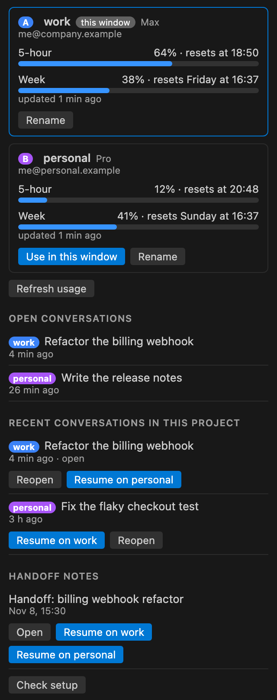
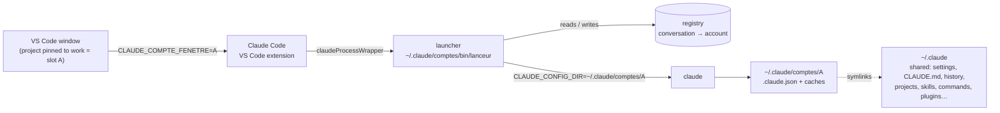

# Twinseat

**Your work and personal Claude Code accounts, side by side in VS Code.**

Each VS Code window runs on its own Claude Code account, and the account follows the project: pin it once in `.vscode/settings.json` and every window you open on that project uses it. One panel shows both accounts' usage. For macOS and Linux; Linux is tested in CI, and desktop reports are welcome.

[](https://github.com/alexdmrx/twinseat/actions/workflows/test.yml)
[](https://github.com/alexdmrx/twinseat/actions/workflows/compat.yml)

[](./LICENSE)

**Install:**
- **VS Code:** [Marketplace](https://marketplace.visualstudio.com/items?itemName=alexdmrx.twinseat).
- **Cursor, Windsurf, VSCodium:** [Open VSX](https://open-vsx.org/extension/alexdmrx/twinseat). Not yet tried in those editors.
- **Other:** the `.vsix` from [Releases](https://github.com/alexdmrx/twinseat/releases).

<p align="center">
  
  <br><sub>The Twinseat panel, rendered from the extension's own panel code with fictional sample data.</sub>
</p>

## Why

Claude Code signs every VS Code window into the same account. If you keep a work account and a personal one, or one per client, you end up either logging out and back in, or spending one account's usage on the other's work without noticing.

Twinseat makes the account a property of the window and of the project, so each piece of work stays on the account it belongs to.

## Requirements

- **The editor:** VS Code 1.94 or later, with Anthropic's Claude Code extension.
- **The accounts:** two Claude accounts that can use Claude Code.
- **The system:** macOS or Linux.

## Features

- **The account follows the project.** Pin a project once and every window on it opens on that account, with no menu and no login dance:

  ```jsonc
  // .vscode/settings.json
  { "twinseat.account": "work" }
  ```

  It can be committed in the repo. A project without a pin reopens on the account you last chose for it. You're only asked until you've chosen once.
- **Two accounts at the same time.** One window on `work`, another on `personal`, both running.
  - **Conversations stay on their account.** They reopen on it after a reload, a crash or a restart.
  - **Moving one is a click.** “Resume on personal” moves a conversation to the other account with its full history.
- **Accounts with names.** `work` and `personal` (or whatever you choose) appear in the panel, the status bar, the menus and the notifications, instead of “A” and “B”.
- **Both accounts' usage in one panel.** It shows the 5-hour and weekly limits of each account and when they reset. Claude Code itself fetches the figures; no message is sent.
- **Safe by design:**
  - Twinseat never reads, stores or forwards your login tokens; each account signs in through Claude Code's own `claude auth login`.
  - **Twinseat: Check and Repair Setup** checks 13 things and fixes only what is safe to fix.
  - **Twinseat: Copy Diagnostics** gives you a report with no email, account name, conversation or token.
  - Uninstalling removes Twinseat's launcher setting from your editor's user settings when the editor next restarts.
- **Kept honest by CI.** The whole test suite runs on macOS and Linux. A nightly job also checks that the settings, commands, flags and internal names Twinseat relies on are still present in the latest Claude Code release.

## Quick start

1. Install Twinseat. The **Twinseat** panel appears in the activity bar.
2. Click **Sign in** on each of the two account cards. A terminal runs `claude auth login` for that account only.
3. Click **Enable** in the panel, or reload the window.

Then use **Rename** on each card to call the accounts `work` and `personal`. Open a project and run **Twinseat: Pin this project to the current account**.

## Status

**Twinseat 0.3.0 is a Preview.**
- **Two-account flows** (one window per account, resuming and moving conversations) were verified end-to-end with two Claude Max accounts in October 2026 (version 0.2).
- **Version 0.3.0** was verified end-to-end with one account on Claude Code 2.1.319 and VS Code 1.141:
  - installed from the `.vsix`;
  - project pin;
  - a real Claude Code session started through Twinseat's launcher;
  - live usage;
  - diagnostics.

  It also runs 174 unit tests and 17 launcher scenarios (16 on macOS) on macOS and Linux.
- **Linux** is covered by CI, but not yet tried on a Linux desktop. Reports are welcome.
- **Not affiliated with Anthropic.** Use your accounts within [Anthropic's terms](https://www.anthropic.com/legal).
- **Twinseat adds no capacity.** Each account keeps its own plan and limits, every conversation runs on exactly one account, and usage is never pooled or transferred between accounts.

## Similar projects

As of November 10, 2026, from each project's own README or Marketplace page:

| | Platforms | Accounts | Scope | Login tokens |
|---|---|---|---|---|
| **Twinseat** | macOS, Linux | 2, named | per window; follows the project | never read |
| [Many Hats for Claude Code](https://github.com/ryankkhalil19/many-hats) | macOS | several | per tab | never read |
| [Claude Parallel Accounts](https://github.com/DercasDrol/claude-parallel-profiles) | Linux, WSL, Remote SSH | several | per window | a local copy per window, never sent |
| [Claude Code Account Switch](https://marketplace.visualstudio.com/items?itemName=NOLANSARL.claude-code-account-switch) | macOS | several | rules per folder | read and refreshed to show usage |

- **If you need more than two accounts, or a different account per tab,** [Many Hats](https://github.com/ryankkhalil19/many-hats) is a good fit.
- **Twinseat is built for the pair:** work and personal, each project on its own account, on macOS or Linux.

## How it works



1. **The window picks its account.** The order is the project's `twinseat.account`, then the account remembered for the project, then a one-time menu. Twinseat puts that account in the extension host's environment, and every Claude process started from the window inherits it.
2. **A launcher starts Claude on that account.** The Claude Code extension can start Claude through a wrapper (`claudeCode.claudeProcessWrapper`). Twinseat's wrapper is a small POSIX `sh` script, [`resources/lanceur.sh`](./resources/lanceur.sh). It picks:
   1. the account recorded for the conversation being resumed;
   2. otherwise the window's account;
   3. otherwise the last account used for the project;
   4. otherwise the first account.

   It then runs `claude` with `CLAUDE_CONFIG_DIR` pointing at that account's folder. For a new conversation it adds `--session-id=<uuid>`, so the registry knows the account before Claude starts.
3. **One setup, two identities.** Each account folder links to `~/.claude` for settings, `CLAUDE.md`, history, projects, skills, commands and plugins. Each account keeps its own `.claude.json` (identity) and its credentials:
   - on macOS, Claude Code keeps them in the keychain, one entry per folder;
   - on Linux, in the account's folder.
4. **Usage comes from Claude Code itself.** A short-lived `claude -p --input-format stream-json` receives a `get_usage` control request: no prompt, no MCP servers, no hooks.

The Claude Code facts this design depends on, and the pitfalls found along the way, are in [docs/architecture.md](./docs/architecture.md).

## What it changes on your machine

| Where | What | When |
|---|---|---|
| `~/.claude/comptes/` | The two account folders (symlinks plus their own `.claude.json`), `bin/lanceur`, the registry, project memory, usage cache, a launch log (time, account, mode, conversation ID; never any content) | First activation |
| `.claude.json` of each account | Seeded once from `~/.claude.json`: UI flags, trusted projects and MCP server definitions (which may contain API keys), never your identity; written with mode 600 | First activation |
| `~/.claude/` | Creates any missing shared folder, empty, so the links resolve | First activation |
| Integrated terminals | `CLAUDE_CONFIG_DIR` set to the window's account, so `claude` typed in the terminal uses the same account | While Twinseat is enabled |
| Editor user settings | `claudeCode.claudeProcessWrapper` → the launcher. Never replaces another program's wrapper | **Enable**, or at startup once both accounts are signed in (unless you ran **Disable everything**) |
| `~/.zshrc`, `~/.bashrc` or an existing `~/.bash_profile` | The `claude-a` / `claude-b` aliases | Only if you run **Twinseat: Add claude-a / claude-b shell aliases**, after confirming |

Outside `~/.claude/comptes`, nothing is moved or deleted.

## Settings

| Setting | Scope | What it does |
|---|---|---|
| `twinseat.accountLabels` | user | Names for the two accounts, e.g. `{"A": "work", "B": "personal"}` |
| `twinseat.account` | project | The account this project uses: a name, or `A` / `B` |

## Commands

| Command | What it does |
|---|---|
| Twinseat: Choose this window's account | Switch the window; conversations already open keep their account |
| Twinseat: Pin this project to the current account | Writes `twinseat.account` to the project's settings |
| Twinseat: Name an account… | Sets `work`, `personal`… |
| Twinseat: Sign in to an account | Runs `claude auth login` for that account only |
| Twinseat: Enable / Disable everything | Sets or removes the launcher setting |
| Twinseat: Refresh usage | Asks Claude Code for both accounts' usage now |
| Twinseat: Check and Repair Setup | 13 checks; repairs only what is safe |
| Twinseat: Copy Diagnostics | A report for bug reports, with no personal data |
| Twinseat: Add claude-a / claude-b shell aliases | Asks first, names the file |

## Uninstall

1. Run **Twinseat: Disable everything** first. This removes the launcher setting right away, in this editor.
2. Uninstall the extension.

As a safety net, uninstalling also removes the launcher setting when the editor next restarts, wherever it still points to Twinseat's launcher:
- **Desktop editors:** VS Code, Insiders, Code - OSS, VSCodium, Cursor and Windsurf, profiles included;
- **Remote servers:** their machine settings.

Editors where Twinseat is still installed are left alone. Comments and formatting are kept, and a file that can't be edited safely is left untouched. All of this is tested against settings files, not yet inside Cursor, Windsurf or remote windows.

To also remove Twinseat's data, delete `~/.claude/comptes`. That signs both Twinseat accounts out:
- on macOS, their keychain entries stay until you delete them in Keychain Access;
- on Linux, their credentials are inside that folder and go with it.

Your original `~/.claude` sign-in is untouched.

> [!WARNING]
> Delete `~/.claude/comptes` only after **Twinseat: Disable everything**, or after uninstalling **and** restarting the editor. While the launcher setting points to it, Claude Code cannot start.

## Known limitations

- **Exactly two accounts.** That is the design; see [Similar projects](#similar-projects) for more.
- **Windows is not supported.** Twinseat stays inactive there and says so.
- **Remote windows are not tested** (Remote SSH, WSL, dev containers).
- **It relies on undocumented Claude Code behaviour:** the wrapper calling convention, the `--resume` / `--session-id` forms, the `get_usage` request, view and command IDs of the Claude Code extension. The [nightly check](./.github/workflows/compat.yml) catches a renamed or removed one within a day of a release. A change in behaviour behind an unchanged name still needs a real test.
- **Plan mode is not restored.** Claude Code's documentation says it does not restore plan mode when a process wrapper is set. A conversation that ended in plan mode therefore resumes in the default mode.
- **An interrupted answer is not resumed after a reload.** With a wrapper set, the Claude Code extension no longer resumes an answer cut short by a window reload.
- **`/clear` conversations follow the window.** A conversation started by `/clear` is not in the registry, so it follows the window's account when reopened.
- **It activates on startup (`*`),** so that the account is set before restored Claude tabs start.
- **Handoff notes need personal commands.** The “Handoff notes” section and the “Copy /relais” button work with personal `/relais` and `/reprendre` commands that are not part of this repository. Without those commands, the section is hidden and the button is not offered.
- **Some internal names are French:** command IDs (`claudeComptes.*`), `~/.claude/comptes`, code identifiers. They come from the project's first name, “Comptes Claude”, and were kept so existing setups keep working.

## Development

```sh
npm ci
npm test                    # TypeScript build, unit tests, launcher scenarios
npm run package             # twinseat.vsix
sh scripts/compat-check.sh <claude-code-extension-dir> <claude-binary>
```

## How it was built

I specified, tested and reviewed it. Most of the code was written with Claude Code. Before each release, the code and these docs went through adversarial reviews.

## License

[MIT](./LICENSE). Not affiliated with Anthropic. “Claude” and “Claude Code” are trademarks of Anthropic.
