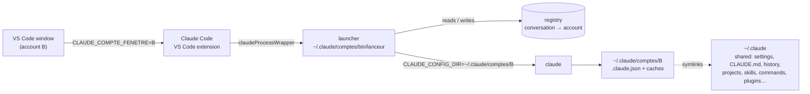

# Comptes Claude

A VS Code extension that runs **two Claude Code accounts side by side on one Mac**. Each window uses one account, one panel shows both accounts' usage, and a conversation can be moved to the other account with its full history.

[](https://github.com/alexdmrx/claude-comptes/actions/workflows/test.yml)

[](./LICENSE)

## Status

**This is a personal tool, published as a reference.** I built it in October 2026 for my own setup and used it daily until I went back to a single account.

- **Last tested with** Claude Code 2.1.289 and the Claude Code VS Code extension 2.1.291.
- **May break with newer versions**, because it relies on undocumented Claude Code behaviour (see [Known limitations](#known-limitations)).
- **Not actively maintained.** I read issues, but I don't promise fixes.
- **macOS only.**
- **French** is used for the UI and the code identifiers; the docs are in English.
- **Use it with accounts you own, within Anthropic's terms.** Every conversation runs on exactly one account and counts against that account's limits. Nothing is pooled or shared between accounts.
- **Not affiliated with Anthropic.**

<p align="center">
  
  <br><sub>The side panel, rendered from the extension's own panel code with fictional sample data.</sub>
</p>

## Why

Claude Code already supports several accounts: each one gets its own configuration directory through `CLAUDE_CONFIG_DIR` (the [official docs](https://code.claude.com/docs/en/authentication) use work and personal accounts as the example). In a terminal, that is just an alias.

In VS Code, two things get in the way:
- **One account for every window.** The Claude Code extension starts every session with the same environment.
- **Separate setups.** Each configuration directory holds its own settings, history, skills, commands and MCP servers, so two accounts mean two setups that drift apart.

This extension makes the account a property of the **window**. Most of the setup stays shared between the two accounts; the exact split is under [How it works](#how-it-works).

## Features

- **One account per window.** The account is picked when the window opens and remembered per project. You can change it from the status bar (`Claude : A`). The change only affects new conversations.
- **Conversations stay on their account.** A small registry records the account each conversation started on. After a reload, a crash or a reopen, the conversation opens on that same account.
- **Move a conversation to the other account.** For the five most recent conversations of the project, “Reprendre sur B” resumes the same conversation, with the same history, under the other account.
- **Both accounts' usage in one panel.** The panel shows the 5-hour and weekly usage of both accounts. It refreshes every 5 minutes by asking Claude Code itself; no message is sent. A notification appears at 90 % of either limit.
- **Always know which account you're on.** An A/B badge sits on Claude tabs. The integrated terminal follows the window's account, and the `claude-a` / `claude-b` aliases do the same outside VS Code.
- **Long-conversation alert.** You are warned once a conversation passes about 160k tokens of context.

## How it works



1. **The window sets an environment variable.** On activation, the extension puts `CLAUDE_COMPTE_FENETRE` in the extension host's environment. Every Claude process started from that window inherits it.
2. **A launcher picks the account.** The Claude Code extension can start Claude through a wrapper (`claudeCode.claudeProcessWrapper`). The wrapper here is a POSIX `sh` script ([`resources/lanceur.sh`](./resources/lanceur.sh)), and it picks the account in this order:
   1. the account recorded for the conversation being resumed;
   2. the window's account;
   3. the last account used for this project;
   4. account A.

   It then runs `claude` with `CLAUDE_CONFIG_DIR` pointing at that account's directory.
3. **Every new conversation gets its ID from the launcher.** For a new conversation, the launcher adds `--session-id=<uuid>`. The registry can then record the account *before* Claude starts, so a later `--resume` always finds it.
4. **Most of the setup is shared, the identities stay separate.** `~/.claude/comptes/A` and `B` each mix three kinds of content:

   | Kind | What | Effect |
   |---|---|---|
   | **Linked** (symlinks to `~/.claude`) | `settings.json`, `CLAUDE.md`, `history.jsonl`, `projects/`, `skills/`, `commands/`, `agents/`, `hooks/`, `plugins/` and the other working folders | Always shared |
   | **Copied once** (from `~/.claude.json`, when the account folder is created) | MCP servers, trusted projects, UI flags, migration markers | A server added later must be added to each account |
   | **Separate** | `.claude.json` (identity and per-account state), caches, and every file not in the list, `keybindings.json` for example | Per account |
5. **Usage comes from Claude Code itself.** A short-lived `claude -p --input-format stream-json` process receives a `get_usage` control request and nothing else: no prompt, no MCP servers, no hooks. When that fails, the panel falls back to the usage Claude Code caches in each account's `.claude.json`.

The Claude Code facts this design depends on, and the pitfalls found along the way, are in [docs/architecture.md](./docs/architecture.md).

## Engineering notes

- **Claude starts, whatever happens.** If the registry, the account folder or anything else is missing, the launcher starts `claude` unchanged. It refuses in exactly one case: a conversation that is already open in another tab, because two processes would write the same history.
- **Login credentials stay with Claude Code.** Each account logs in with Claude Code's own `claude auth login`, run with that account's `CLAUDE_CONFIG_DIR`. Claude Code keeps the OAuth credentials in the macOS keychain, one entry per configuration directory. The extension never reads, stores or forwards them. It does read each account's email address from `.claude.json`, to show it in the panel.
- **Copying never overwrites.** When an account folder is created, an allow-list of keys is copied from `~/.claude.json`. That includes MCP server definitions, which may contain API keys, so the copy is written with mode `600`. A deny-list keeps identity keys (`oauthAccount`, `userID`…) and caches out. Existing files are never overwritten: a conflict is logged and left alone.
- **The webview is locked down.** Scripts run only with a per-load nonce. The webview renders with `textContent` only (never `innerHTML`), accepts a closed list of actions, and checks conversation IDs and note names before any command runs.
- **Several windows can run at once.** Registry, project and usage files are written to a temp file and then renamed. A lock file ensures that only one window refreshes usage at a time. One-shot markers are created with the `wx` flag.
- **The core is testable without VS Code.** Paths, installation, registry, usage, formatting and relay notes never import `vscode`. 22 `node:test` unit tests cover:
  - formatting;
  - the installer (idempotence, conflicts left intact);
  - the identity filter;
  - registry and project keys;
  - relay notes.

  The launcher has its own suite: 14 scenarios and 21 checks against a fake `claude`.

## What it changes on your machine

| Where | What | When |
|---|---|---|
| `~/.claude/comptes/` | `A/` and `B/` (symlinks plus their own `.claude.json`), `bin/lanceur`, `registre/`, `projets/`, `quotas/`, `alertes-contexte/`, `journal.log` (one line per launch: time, account, mode, conversation ID; never any content) | First activation |
| `~/.claude/` | Creates any missing shared folder, empty, so that the links resolve | First activation |
| `~/.zshrc` | Appends the `claude-a` and `claude-b` aliases, once, **without asking** | First activation |
| VS Code user settings | `claudeCode.claudeProcessWrapper` → the launcher. It never replaces a wrapper that is already set | When you activate it (see [Install](#install)) |
| macOS keychain | One Claude Code credentials entry per account, created by Claude Code's own login | When you log in |

Outside `~/.claude/comptes`, nothing is moved or deleted. Inside it, the extension rotates its own log and removes old registry entries and alert markers.

## Install

**Requirements:**
- macOS;
- VS Code 1.94 or later, with the Claude Code extension;
- two Claude accounts that can use Claude Code;
- Node.js 22 or later, only to build or test from source.

**From the release:** download `claude-comptes.vsix` from [Releases](https://github.com/alexdmrx/claude-comptes/releases), then run:

```sh
code --install-extension claude-comptes.vsix
```

**From source:**

```sh
npm ci
npm test
npm run package   # builds claude-comptes.vsix
```

**Then:**
1. Open the **Comptes Claude** panel in the activity bar.
2. Click **Se connecter** for account A, then for account B. Each click opens a terminal that runs `claude auth login` for that account.
3. Click **Activer** in the panel, or reload the window: this sets the wrapper. From then on, each window gets its account.

## Uninstall

1. Run **Comptes Claude : tout désactiver** from the command palette. This removes the wrapper setting; if you skip it, the setting stays after uninstalling.
2. Uninstall the extension.
3. Optionally, remove the two aliases from `~/.zshrc` and delete `~/.claude/comptes`. Each account's `.claude.json` goes with it, including any MCP server added since. The keychain entries stay; delete them in Keychain Access if you want.

> [!WARNING]
> Never delete `~/.claude/comptes` while `claudeCode.claudeProcessWrapper` still points to it: Claude Code would no longer start in VS Code.

## Known limitations

- **macOS only.** It relies on the keychain, `uuidgen` and `pgrep`, and nothing checks the platform.
- **Exactly two accounts**, A and B.
- **Undocumented Claude Code behaviour it relies on:**
  - the wrapper calling convention, `wrapper <binary> <args…>`;
  - the `--resume=<id>` and `--session-id=<id>` argument forms;
  - the `get_usage` control request, and the `cachedUsageUtilization` field of `.claude.json`;
  - the location of the `claude` binary inside the Claude Code extension;
  - the history layout, `projects/<project key>/<id>.jsonl`;
  - the `claudeVSCodePanel` webview type and the Claude view IDs, used for the badges;
  - the `claude-vscode.editor.open` command.
- **An interrupted answer is not resumed after a reload.** With a wrapper set, the Claude Code extension no longer resumes an answer cut short by a window reload (observed with 2.1.291).
- **`/clear` conversations follow the window.** A conversation started by `/clear` is not in the registry, so it follows the window's account when reopened.
- **Activation on startup (`*`).** This is needed so the account is set before restored Claude tabs start.
- **Some buttons rely on personal commands that are not in this repository:**
  - the “Copier /relais” button in the usage and long-conversation alerts;
  - the “Relais” section of the panel, which lists handoff notes written by `/relais`;
  - its “Reprendre sur A / B” buttons, which type `/reprendre`.

  Without these commands, the section stays empty and the buttons only copy text.

## Tests

```sh
npm test
```

This compiles the TypeScript, runs the `node:test` unit tests (`src/test/`) and runs the launcher scenarios (`tests/lanceur.test.sh`). CI runs the same command on macOS.

## How it was built

I specified, tested and reviewed it. Most of the code was written with Claude Code, and each part went through an adversarial review pass before it was installed.

## License

[MIT](./LICENSE)

Not affiliated with Anthropic. “Claude” and “Claude Code” are trademarks of Anthropic.
